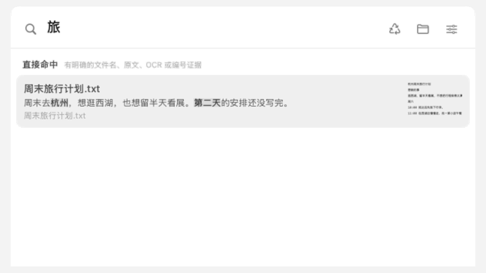

<div align="center">



# AI Everything

### 找到所需，接着创造。

**不记得文件名，也能从内容找回。没完成的想法，还能接着做。**

为 Mac 打造的本机优先搜索与文件再创作工具。

[下载 macOS 预览版](https://github.com/Boole-Highland-Insight/AI-Everything-Public/releases/tag/v0.1.0) · [安装指南](docs/INSTALL.md) · [隐私说明](docs/PRIVACY.md) · [参与开发](CONTRIBUTING.md)

macOS 14+ · Apple Silicon · 中文界面 · MIT 开源



[观看 8 秒演示视频](docs/demo/demo.mp4) · 演示由应用真实界面与合成样例生成，不含私人文件；过程经过剪辑，不代表模型实际耗时。

</div>

> 当前为 **v0.1.0**。DMG 尚未获得 Developer ID 签名和 Apple 公证，首次打开可能被 macOS 拦截，请先阅读[安装指南](docs/INSTALL.md)。EmbeddingGemma 2 向量模型随 App 附带；Qwen3-VL 内容理解模型按所选方案单独下载。本机搜索无需注册账号，也无需 API Key。

## 记得内容就够了

**「那份没写完的旅行计划」**、**「关于审批流程的文档」**——从你选择的资料夹中，搜索文件名、正文、OCR 文字和内容摘要。混合关键词与本机向量检索，尽量把“记得大概意思”变成可以打开的文件。

- **找到具体位置。** 结果可显示命中片段、PDF / PPTX 页码，以及已索引音视频的时间点。视频可从对应位置播放。
- **按一下就出现。** `⌥ Space` 唤起搜索，`Return` 打开，`Space` 预览，`⌘ Return` 在 Finder 中定位。
- **结果分层显示。** 文件名、正文与语义检索的结果合并后分为直接命中与可能相关，并标注命中依据。
- **可选自动精排。** 默认关闭。在设置中开启「自动精排」并配置 OpenRouter Key 后，Jev 会对本机已检索出的候选重新判断排序；云端会收到查询与候选片段，详见[隐私边界](docs/PRIVACY.md)。

## 让后台慢慢做，让你继续工作

选好资料夹，文件清单先就绪，正文识别和内容理解随后补齐。新增与修改的内容增量更新，已经完成的内容随时可搜。

扫描支持暂停、失败重试和中断后继续；设置中分阶段显示进度与原因。原文件留在原处，搜索资料保存在这台 Mac 的 SQLite 数据库中。

三种本机方案，按设备和需要选择：

| 方案 | 使用的模型 | 适合做什么 |
|---|---|---|
| 语义索引 | EmbeddingGemma 2（随 App 附带） | 为正文、OCR 文字和图片 / 页面生成本机向量，资源占用较低 |
| 轻量理解 | **Gemma + Qwen3-VL 4B** | 增加内容摘要和图片描述，兼顾速度与理解 |
| 深度理解 | **Gemma + Qwen3-VL 8B** | 使用更大模型理解内容，需要更多内存和扫描时间 |

“B”表示十亿参数。不是三个都安装；三档共用随 App 附带的 EmbeddingGemma 2 向量模型，后两档再下载一种内容理解模型（通过本机 Ollama 运行）。建议 16GB 内存先试轻量理解，24GB 及以上可尝试深度理解；实际速度取决于设备和资料规模。

## 咔哒一下，旧文件有了下一步

一篇停在半途的文章，一张还没画完的草图，或一份值得再打磨的材料——从「补全」或「优化」开始，选择四个建议方向之一，也可以写下自己的要求。

**选择方向 → 生成新版本 → 左右对比 → 继续提问、继续修改。**

- 原文与新版本并排预览，文本、图片、PDF 使用对应的预览方式，两边都能单独打开。
- 原件默认保留，生成结果另存；再次提问会针对当前版本继续修改。
- `.pptx` 保持可编辑的 PowerPoint 格式；PDF 生成新版 PDF。
- 不想处理的文件，点「不再推荐」，应用记住你的选择。
- 完全重复文件按内容哈希成组展示，由你预览和选择。主动移入应用垃圾桶后，30 天内可还原。

「咔哒一下」需要自行配置 OpenRouter API Key，所选内容会发送至云端模型，费用由模型提供方计收。草稿识别和生成内容可能有误，发布或使用前请检查。

## 从一个资料夹开始

1. [下载 DMG](https://github.com/Boole-Highland-Insight/AI-Everything-Public/releases/tag/v0.1.0)，将 **AI Everything** 拖到 **Applications**。
2. 打开应用，按引导选择一个资料夹和本机模型方案。先用小型资料夹体验更方便。
3. 文件清单就绪后按 `⌥ Space` 搜索；模型下载和内容分析可在后台继续。
4. 想使用云端精排或再创作，再到 **设置 → 云端** 填入 OpenRouter Key。

遇到无法打开、模型下载失败、结果不完整？查看[安装与使用指南](docs/INSTALL.md)。

## 你的资料，边界清楚

| 操作 | 在哪里处理 |
|---|---|
| 文件名 / 正文检索、系统 OCR、本机向量与已安装的本机理解模型 | 本机 |
| 开启「自动精排」并配置 Key 后的 Jev 搜索判断 | 云端：查询、候选相对路径及命中片段 |
| 主动点击「咔哒一下」与后续修改 | 云端：所选文件内容、要求和必要的版本内容 |

新手引导选择本机方案后，后台扫描不会自动回退云端。无需云端功能时不填 Key 即可。模型下载需要网络；云端服务适用其各自的数据政策。

[完整隐私说明](docs/PRIVACY.md)包含本机数据位置、旧版兼容行为和移除资料夹后的数据保留方式。

## 开源，也欢迎一起打磨

AI Everything 使用 **SwiftUI + AppKit + SQLite / GRDB**。公开仓库包含应用源码、构建工具及合成测试，不包含个人资料库或模型权重；构建时会从官方来源下载并校验 Gemma 模型。

```sh
git clone https://github.com/Boole-Highland-Insight/AI-Everything-Public.git
cd AI-Everything-Public
bash apps/macos/AIEPopup/build.sh
open "apps/macos/AIEPopup/build/AI Everything.app"
```

构建需要 Swift 6.1+、CMake 与 macOS SDK；首次构建会编译固定版本的 llama.cpp 并下载约 860 MB 模型，完整 App 约 859 MB。下载版运行不需要安装开发工具。预编译 DMG 目前提供 Apple Silicon 版，Intel 可尝试源码构建，尚未在 Intel 实机验收。

- [开发与验证](docs/DEVELOPMENT.md) · [贡献指南](CONTRIBUTING.md)
- [反馈问题](https://github.com/Boole-Highland-Insight/AI-Everything-Public/issues) · [安全问题私下报告](SECURITY.md)
- [版本记录](CHANGELOG.md) · [MIT 许可证](LICENSE) · [第三方说明](THIRD_PARTY_NOTICES.md)

当前重点是搜索与扫描稳定性、草稿判断和再创作体验。欢迎使用合成样例反馈漏检、误判和交互问题；请勿上传 API Key、私人文件或完整数据库。
