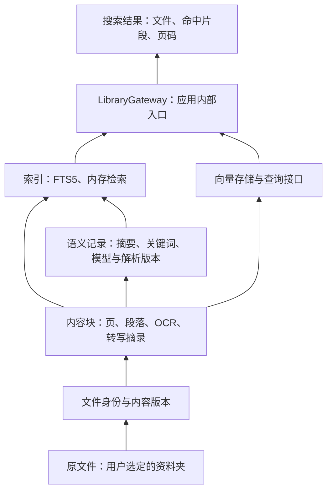

# 本机分层数据与检索

本文描述当前实现。GRDB 是 Swift 访问 SQLite 的基础库；文件分层、内容提取、语义记录和权限范围由 AI Everything 实现。数据库不需要独立服务、账号或云存储。

## 层次与职责



- **原文件层**：文件仍在资料夹中，数据库不保存原始文件二进制。`files` 记录位置与当前版本，`file_versions` 用 SHA-256 标识内容版本。
- **块层**：`chunks` 保存父子关系、原文、块类型、页码或位置信息、解析器版本。PPTX/PDF 先按页，长页再按结构拆成子块；文本按标题、段落、句子边界切分；文件级根块负责组织其下的内容。
- **语义层**：`semantic_records` 与块关联，单独保存摘要、关键词、生成方法和模型版本。旧 QuickScan 摘要挂在文件根块；不会将一条文件摘要复制到所有页面。当前块摘要是本机提取的短摘录，不代表逐块模型理解。
- **索引层**：`search_documents_fts` 使用 SQLite FTS5 多字段索引，分别保存文件名、路径、标题、正文、OCR、图表文字、摘要和关键词。索引层是派生数据，可以从内容单元重建。正常搜索热路径没有模型调用。
- **Gateway**：`LibraryGateway` 统一索引加载、查询和内容块读取。目前是应用内部 Swift 接口，没有启动 HTTP 服务或 MCP Server。

## 构建 Workflow

数据库不是一次性由 8B 填满，而是按层次渐进构建。前几层负责让文件尽快可搜索，后几层在后台补充 OCR、向量和深度理解。

| 顺序 | 层次 | 谁执行 | 输入 | 产物 | 主要写入 | 用户感知 |
|---|---|---|---|---|---|---|
| 0 | 来源与授权 | 资料夹选择、Photos 授权、LibraryRoots | 用户选择的资料夹或图库 | 授权来源、扫描范围、根目录状态 | `sources`、`roots` | 用户看到资料夹已加入，文件开始出现 |
| 1 | 文件发现 | Foundation、URLResourceValues、UniformTypeIdentifiers | 文件系统枚举结果 | 文件名、路径、类型、大小、修改时间、逻辑 Item | `items`、`item_locators`、`files` | 可以按文件名、路径、类型和时间搜索 |
| 2 | 内容版本 | CryptoKit SHA-256、内容指纹逻辑 | 当前文件字节、大小、mtime | 当前版本、内容 hash、版本身份 | `file_versions`；`item_versions` 兼容视图 | 文件修改后不会继续使用旧索引 |
| 3 | 原生内容提取 | PPT/PDF/DOCX/XLSX/TXT/Archive/MSG/XML 解析器 | 文件当前版本 | 页、段落、sheet、转写片段等可定位证据 | `chunks`、`content_units`、`unit_contents` | 可以搜到 PPT 页、PDF 页、正文、表格、邮件正文 |
| 4 | 本机 OCR / 系统视觉 | Apple Vision、macOS 本机分析 | 图片、扫描 PDF、截图、抽帧 | OCR 文字、基础标签、截图/空白/线稿等轻量判断 | `analysis_records`、`analysis_fields`、`unit_contents`、`search_documents` | 图片和扫描件开始能被文字搜到 |
| 5 | 搜索投影 | SearchEncoding、SQLite FTS5 | 文件名、路径、标题、正文、OCR、摘要、关键词 | 多字段 FTS 文档、数字片段、可重建搜索缓存 | `search_documents`、`search_documents_fts` | 输入关键词时快速返回结果和命中片段 |
| 6 | 语义向量 | EmbeddingGemma 2、随 App 附带的 llama.cpp 运行时 | 已提取的内容单元文本、OCR、标签、短摘要，以及图片 / 页面 | 文本与视觉 embedding | `features(feature_type='text_embedding')`；版本化、归一化 Float16 BLOB | 自然语言模糊搜索更容易召回相关内容 |
| 7 | 深度理解 | Qwen3-VL 8B | 少量需要理解的内容单元、OCR、低分辨率视觉材料 | 视觉描述、页面摘要、主题、实体、重要数字、搜索短语 | 权威原始记录 `analysis_records`；结构化投影 `observations`、`model_runs`、`jobs` | 搜索解释更准，回收/未完成/咔哒有更好的判断依据 |
| 8 | 精搜重排 | Qwen3-VL 8B、LocalRerank | FTS/向量已经召回的 Top 候选 | 候选编号排序、是否相关的判断 | 不直接改权威内容；可记录到 `model_runs` | 用户点「精搜」后，模糊结果被重新筛选和排序 |
| 9 | 关系与清理 | hash、未来 pHash/dHash、Apple Vision Feature Print、规则分类器 | 文件版本、图片特征、内容观察 | 完全重复、近重复、来源-产物、低价值/未完成关系 | `relations`、`features`、`trash_records` | 回收页、重复文件、咔哒产物关联更准确 |

这张表里，`unit_contents` 保存可验证的原始内容，例如原生文字、OCR、转写和表格文本；`observations` 保存模型判断，例如 8B 的视觉描述、主题和摘要；`search_documents` 只是为了快速搜索派生出的扁平缓存，可以从前两者重建。

搜索结果保留 `chunkID` 和页码，能展示「第 3 页 · …」。页级 PDF 命中会用 PDFKit 直接打开到对应页。安装 Keynote 时，页级 PPT/PPTX 命中通过 Keynote 自动化跳到对应幻灯片；首次使用需允许系统“自动化”权限。没有页码、Keynote 不可用或自动化被拒绝时，回退为系统默认方式打开。

## 数据表

| 表 | 用途 |
|---|---|
| `analysis_records` / `analysis_fields` | 扫描结果的权威存储：字段类型、嵌套关系、数组顺序、OCR、置信度、错误、转写断点、云端标记和来源信息 |
| `migration_imports` | 每个资料根及旧记录的一次性导入标记 |
| `file_preferences` | 保留和暂缓扫描的文件偏好 |
| `trash_records` | 垃圾桶清单、分析记录身份及移动/恢复/清除操作状态 |
| `work_leases` | 跨进程显式转写任务租约 |
| `roots` | 用户所选资料根及当前启用状态 |
| `files` | 本机文件身份、路径和当前内容版本 |
| `file_versions` | 内容哈希、覆盖范围、导入签名 |
| `item_versions` | 指向 `file_versions` 的兼容只读视图，为新命名提供逐步迁移入口 |
| `chunks` | 原文块、父子关系和来源位置 |
| `semantic_records` | 与原文分开的摘要和关键词 |
| `search_documents_fts` | 按字段加权的全文索引；由搜索投影重建 |
| `scan_jobs` | 按文件版本保存本机分析、QuickScan、索引阶段状态 |
| `artifact_links` | 咔哒产物与源文件版本的关系 |
| `photo_assets` | Photos 授权来源的增量准备队列、revision、失败重试和本地副本状态 |
| `sources` / `items` / `item_locators` | Phase 1 文件理解模型投影：授权来源、逻辑文件和当前位置历史 |
| `content_units` / `unit_contents` | 面向搜索和展示的可定位证据单元及其原生文字、OCR、转写或表格内容 |
| `search_documents` / `search_documents_fts` | 从内容单元派生的多字段搜索投影，按文件名、路径、标题、正文、OCR、图表、转写、摘要、关键词和实体分别索引 |
| `observations` | Apple Vision 分类/画布判断及 Qwen3-VL 摘要、主题、实体、证据、对象、动作、可见文字、完成状态 |
| `features` | 当前内容 SHA-256 与 Gemma embedding 的统一权威特征表；向量记录模型、模型版本、维度、度量、格式与内容 hash；近重复图像特征仍待接入 |
| `relations` | 当前完全重复关系和咔哒 `generated_from` 来源关系；近重复关系仍待接入 |
| `jobs` / `model_runs` | 按内容版本持久化阶段状态、claim/lease/retry/checkpoint，以及本机/云端处理器、模型 digest、输入指纹和结果 |

`scan_jobs` 是旧兼容阶段投影；`jobs` 使用统一 subject / input hash / priority 状态模型。内存 drain 负责控制线程和资源让路，SQLite `jobs` 负责执行所有权：基础分析与深度扫描必须先原子 claim，运行中保存租约和 checkpoint，失败按 `not_before` 重试。应用重新启动时释放前一进程遗留租约，并从 checkpoint/sidecar继续。未配置 Key 的 QuickScan 可保持 `pending`；`unsupported` 与 `failed` 分开保存。

Phase 1 仍保留旧 `files` / `file_versions` / `chunks` 作为运行兼容层。同步文件快照时，同一事务会把旧块投影到新的 `items`、`content_units`、`unit_contents` 和 `search_documents`。新表不是空占位；它们随现有扫描流程写入，并可从旧块迁移回填。后续阶段可以逐步把 UI 和后台队列改为直接使用这些语义更清楚的表。

升级到 `v6_operational_understanding` 后，已有 sidecar 会在下一次目录 catalog 刷新时投影到 `observations`、`jobs` 和 `model_runs`。这一步复用数据库里的分析结果，不会重新 OCR、重新调用 8B 或改动原文件。

`v7_projection_integrity` 会补回旧版迁移中缺少摘要行而漏掉的 chunk/FTS 投影，并清理已经删除 chunk 对应的孤立 `content_units`、事实、特征、关系和搜索缓存。之后 chunk 删除由数据库触发器同步清理这些派生记录。

`v8_float16_feature_vectors` 会先备份数据库为 `content.sqlite.before-vector-f16.sqlite`，再在同一事务中把旧 JSON Float32 向量转换为带版本头的归一化 Float16 BLOB。迁移逐条校验模型标识、模型版本、维度和内容 hash；全部向量进入 `features` 后才删除 `embedding_spaces` / `embeddings`。迁移不读取原文件，也不调用模型。

`v10_durable_job_scheduler` 为 `jobs` 增加 `checkpoint_json`、`max_attempts` 和领取索引。任务只有在输入 hash、当前文件版本和资料根授权仍有效时才能执行；完成、重试和租约释放都要求匹配领取者，避免两个后台执行者同时写同一阶段。

## 端侧能力如何构建数据库

AI Everything 的本机能力按速度和职责分层写入数据库。首次扫描优先建立可搜索的事实证据，模型理解随后渐进补齐；8B 不参与文件发现、hash、FTS 或全库遍历。

| 能力 | 主要职责 | 写入或影响的表 |
|---|---|---|
| Foundation / UniformTypeIdentifiers / CryptoKit | 读取文件名、路径、类型、大小、时间、内容 hash，建立当前版本 | `sources`、`items`、`item_locators`、`files`、`file_versions` |
| 本机结构解析器 | 提取 PPT/PDF/DOCX/TXT/XLSX/压缩包等原生文字，按页、段落、sheet 或时间段生成可定位证据 | `chunks`、`content_units`、`unit_contents`、`semantic_records`、`search_documents` |
| Apple Vision / macOS 本机分析 | OCR 写事实内容；分类、人数、条码和画布判断写 observation；后续 OCR 坐标应拆入专门表 | `analysis_records`、`analysis_fields`、`unit_contents`、`observations`、`search_documents` |
| 本机音频转写 | 将音频或视频音轨拆成带开始/结束时间的转写块 | `chunks`、`content_units`、`unit_contents`、`scan_jobs` |
| EmbeddingGemma 2 | 为已经提取好的内容单元及图片 / 页面生成语义向量，用于自然语言召回；不生成摘要 | `features(feature_type='text_embedding')` |
| Qwen3-VL 8B | 后台理解少量需要视觉/语义判断的内容单元，生成页面描述、摘要、主题、实体、重要数字和搜索短语；也用于精搜候选重排 | 原始结构保留在分析记录；字段投影到 `observations`，运行来源写入 `model_runs`，阶段写入 `jobs` |
| FTS5 / SearchEncoding | 从内容单元派生多字段搜索投影和数字片段索引 | `search_documents`、`search_documents_fts` |

`features`是所有向量和非向量特征的唯一权威表，能同时表达文字向量、未来的图文共同向量和 Feature Print。文字向量使用 `f16-le-v1-normalized` 格式；搜索、覆盖率统计、缺失任务判断和写入均直接使用该表。`embeddings`是已经由 v8 迁移退役的早期兼容表，不再双写或读取。

语义向量采用全局 1.6 GB 软预算，并按内容类别公平调度：照片 20%、PPT/PDF 等分页文档 30%、普通文档 25%、音视频 20%、其他 5%。这是可借用的调度份额，不是硬分区。正文 chunk、OCR、转写和 FTS 不受该预算裁剪；空间不足时只停止继续生成向量。

Gemma 与 8B 的职责不同：Gemma 只产出向量，帮助“召回可能相关的内容”；8B 产出观察和判断，帮助“理解候选为什么相关”。两者都不修改原文件，写入前都绑定具体内容版本和内容 hash。文件更新后，旧块、旧 observation、旧向量不会代表新版本。

在新的表结构里，8B 不写 `unit_contents`。`unit_contents` 保存原生文字、OCR、转写、表格文字等可验证内容；8B 的结构化输出写入 `observations`，例如 `summary.short`、`topic`、`entity`、`visual.scene`、`document.completeness`。适合搜索的短摘要、实体和关键词再派生到 `search_documents`，后者可以删除重建。音频转写使用独立 `transcript_text` 搜索字段，不再依赖前 180 字摘要才能命中。

## 版本与旧数据迁移

首次升级时自动备份已有 v1 数据库至 `content.sqlite.before-v2.sqlite`，再迁移表结构、导入所选资料夹的旧 sidecar，以及旧垃圾桶清单和文件偏好。迁移本身不调用云端，已有且仍有效的扫描结果会复用。旧 JSON 保持不变。

`analysis_fields` 将异构扫描结果展开成带类型的关系行，保留对象层次、数组顺序和未识别的旧字段；不是把一份 JSON 文档塞进一个数据库单元格。扫描器只在内存中使用字典，通过事务合并自己负责的字段。内容块、语义记录、全文索引和向量仍使用各自专门的表。部分位置/关键词列保留 JSON 编码作为 SQLite 内部字段，不再生成 sidecar 文件。

1. 原文件身份在同一资料根内依据文件系统身份建立，内容版本使用 SHA-256；普通重命名不会制造新的内容版本。编辑器替换文件、移到不同资料根或复制到另一台 Mac 时，可能建立新身份。
2. 旧 sidecar 先核对大小和修改时间，匹配时给本机分析与 QuickScan 分别补记 `sourceHash`。这是兼容旧格式的首次匹配，不能验证历史结果实际生成时的字节内容。
3. 新扫描在处理前后核对内容哈希。原文件改变后，旧块、旧摘要与旧向量不会参与当前版本检索；重新分析时按新版本写入。
4. 同一版本重复导入不会增加重复块。块文本或标签改变后，相关向量失效。
5. 资料夹完整快照在单个事务中更新。读取和查询限制在当前所选资料根，移除目录或删除文件后不再返回对应内容。

扫描完成后直接写入数据库分析记录；保留 `cloudUpload`。新咔哒产物在数据库中写入 `provenance`（源文件 ID、版本 ID、内容哈希和相对路径），Gateway 刷新时建立关联。旧产物不会自动猜测来源；跨 Mac 复制的本机身份尚未自动重新关联。关联浏览界面尚未实现。

## Chunk 切分规则

Chunk 是带来源位置的原文片段，不是摘要。切块过程在本机执行，不请求大模型。

| 内容 | 边界与定位 |
|---|---|
| PPTX / PDF | 先按实际页分组。每页 ≤ 1,600 字符时保留一块；长页创建页父块和文本子块，每个子块保留页码。页结构/形状标签放在父块 |
| Markdown / 普通文本 / DOCX 提取文本 | Markdown 标题优先成为新块起点；随后优先空行段落、句子或换行，过长时退到空白，最后才硬切 |
| CSV / TSV / JSON 文本 | 使用同一文本规则；当前没有单元格、JSON 对象或跨行表头语义解析 |
| 图片 / 视频抽帧 | 图片保留 OCR 与标签；视频最多 8 个抽样帧，每帧保留约一秒时间锚点。不是视觉区域或逐帧切分 |
| 音频转写 | 每个已完成的 45 秒窗口一块，保留开始/结束秒数；末段可短于 45 秒，不是 VAD 断句 |

文本上限 **1,600 个 Swift Character（可见字符簇），不是 token**。同一页或同一文本的子块按原顺序拼接可还原已提取的文本；没有固定重叠，避免原文重复存储。结构过短时允许短块，通常在上限的后三分之二寻找自然边界。字符位置采用 `[characterStart, characterEnd)`，相对于当前页或本次提取的整段文本；记录 `structure-1` 策略版本。

文件根块组织页面/段落，页父块组织页内子块。块摘要当前是最多 180 字符的本机摘录；QuickScan 文件摘要挂在根块。检索命中子块时带出文件和页码，后续可通过父子关系补齐上下文。当前已接入本地 embedding 召回；逐块模型摘要和自动 PowerPoint 翻页尚未实现。

## 内容覆盖范围

| 类型 | 当前块内容与边界 |
|---|---|
| PPTX | 最多 500 页，每页 32,000 字符；页内文字、形状标签与依据，不含备注、母版和嵌入图片逐图 OCR |
| PDF | PDFKit 提取前 500 页可读文本，每页最多 32,000 字符；已有首页 OCR 作为额外块保留 |
| TXT / Markdown / CSV / TSV / JSON | UTF-8 文本前 4 MiB，按最多 1,600 字符切块；表格仍是文本，不是单元格级解析 |
| XLSX | 按工作表与行分组，每组最多 20 个非空行；约 1,100 字符正文加工作表名与首行上下文。保留单元格地址、表名、行范围、隐藏状态；读取共享字符串、内联文字和公式缓存，不计算公式 |
| DOCX | 主文档正文文本，最多 2,000,000 字符；不保留完整排版结构 |
| 图片 | 已有 Vision OCR 与标签 |
| 视频 | 全时长最多 8 个抽样帧：Apple Vision OCR/标签与本机 8B 画面描述分别成块并保留采样秒数；带音轨时自动 Whisper 转写。不是全片逐帧索引 |
| 音频 | Whisper 本机转写，每个完成的 45 秒窗口一块；保留实际时长与断点，可跳到窗口起点，无词级时间定位 |
| MSG | 读取 CFB 顶层 MAPI Unicode / ANSI 主题、收发件人显示名与正文；HTML 回退不加载外部资源。文件最多 32 MiB，单流最多 16 MiB；不解析附件或仅含压缩 RTF 的邮件 |
| XML | 最多 4 MiB，提取元素路径、文字、CDATA 和属性，禁止外部实体解析 |
| RAR / ZIP / 7Z / TAR / GZ | 系统 libarchive 通过 stdout 读取包内 TXT / MD / CSV / TSV / JSON / XML；保留成员路径。最多 200 个成员、每个 4 MiB、合计 16 MiB；不落地解压、不递归展开，不支持或遗漏的成员标记部分覆盖 |

XLSX 当前最多读取 100 张工作表、50,000 个非空行、4,000,000 字符的单元格展开内容；单个 XML 条目最多 32 MiB，总 XML 最多 64 MiB。触及上限或遗漏工作表时标记 `partial`。日期、百分比等样式暂不渲染，数值保留文件中的原始值；合并区域的文字位于原锚点单元格，不展开复制；不提取图表、图片或批注。旧版 `.xls` 仍需另存为 `.xlsx`。

`coverage` 记录提取范围；没有明确完整性保证的类型默认标记 `partial`。此版本没有将全部格式转换成统一的完整多模态文档。

## 扩展接口

独立 Swift 模块 `AIEData` 位于 `core/AIEData/`，主要接口：

- `ContentStore.synchronize(documents:rootPaths:)`：提交授权资料根的完整快照；不是增量单文件更新接口。
- `search(allTerms:anyTerms:rootPaths:limit:)`：块级全文查询；每个 `allTerms` 分组内部为同义词 OR，分组之间为 AND。
- `chunk(id:rootPaths:)`：读取当前版本的原文证据与位置。
- `putEmbedding(chunkID:spaceID:modelID:modelVersion:vector:rootPaths:)`：接收模型实际输出的向量，校验维度及模型空间。
- `searchVector(_:spaceID:rootPaths:limit:)`：指定模型空间中的精确余弦查询，适合初期本机规模；尚未使用 ANN 向量索引。
- `linkArtifact(sourceVersionID:artifactFileID:relation:rootPaths:)`：关联生成产物与授权范围内的源文件版本。

应用已接入 EmbeddingGemma 2 本机语义召回，通过 RRF 与全文及规则结果融合。后续逐块语义分析应写入独立记录，不得用摘要覆盖原文块。MCP 适配层可复用只读查询和证据接口，但应另行实现调用方授权与能力限制。API Key 的现有配置见[隐私说明](PRIVACY.md)。

## 存储、恢复与隐私

数据库位于 `~/Library/Application Support/AI Everything/Index/content.sqlite`，使用 WAL、外键和 GRDB 版本化迁移。数据库目录权限为 `0700`，主文件为 `0600`；SQLite 本身未加密。数据库含提取文本、摘要与路径，应按用户资料保护，不应提交或分享。`.sqlite` 及 WAL/SHM 文件已加入 Git 忽略规则。

移除目录只撤销检索可见性，**不会立即擦除历史块、摘要或版本记录**。应用垃圾桶的 30 天清除规则不负责清除数据库历史。当前没有历史保留期限或定期清理功能。

**数据库现在是权威数据，不能再把 `Index` 目录当作可随时删除的缓存。** 删除数据库会丢失新扫描结果、转写断点、云端标记、文件偏好和垃圾桶清单；原文件不能重建这些操作历史。

一致性备份命令（不会覆盖已有文件）：

```sh
"apps/macos/AIEPopup/build/AI Everything.app/Contents/MacOS/AIEPopup" \
  --backup-database /absolute/existing-directory/aie-backup.sqlite
```

备份使用 SQLite 在线备份 API，包含已提交的 WAL 内容，输出权限为 `0600`。恢复前完全退出应用，把整个当前 `Index` 目录移走留备份，创建新的 `Index` 目录，再将备份复制为 `content.sqlite`；不要保留另一份数据库的 `-wal` / `-shm` 文件。垃圾桶中的实际文件需要连同 `Trash` 目录单独备份。API Key 不包含在数据库备份内。

正常启动/资料刷新会从数据库分析记录和当前原文件重新同步派生的块与索引，不需要删除数据库。首次升级的自动备份和旧 `scanner/` 可以用于迁移回退；恢复旧版本会失去升级后的新操作记录，不能将新旧库直接混合。

旧 `scanner/` 仅在每个资料根首次迁移时读取，迁移成功后不再读取或写入。损坏 JSON 或读取失败会使迁移停止，已有成功导入的记录保留，下次可继续；不会静默把坏文件当空记录。确认迁移后该目录不再是运行必需品，建议先保留作备份。

垃圾桶操作先将 `moving` / `restoring` / `purging` 状态写入数据库，再移动文件，最后提交完成状态。分析身份跟随文件保留，恢复遇到同名文件时另取名称。重启时只自动确认结果明确的中断操作，不确定的重复副本会保留等待处理。原文件与 SQLite 无法实现同一个跨系统事务，因此采用操作日志进行恢复。

数据库初始化或迁移失败时，应用显示错误提示，保留基础文件名索引并暂停扫描；不会退回 JSON 写入。不要在应用运行时直接编辑 SQLite 文件。

离线合成数据检查和诊断命令见 [开发与验证](DEVELOPMENT.md)。

音视频轨道检查、显式转写和时间块的最新接口见 [音视频扫描后端](MEDIA.md)。
